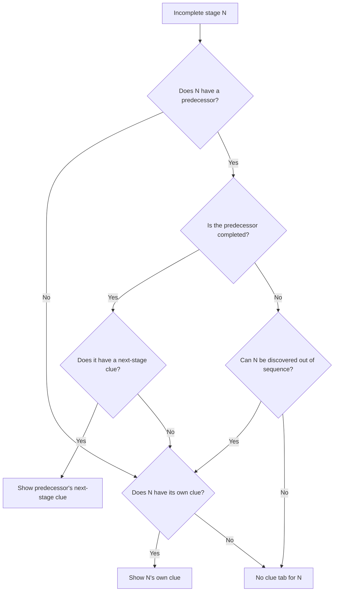

# moodle-mod_treasure
Activity module for Moodle that allows to run outdoor, indoor (QRCodes), virtual maps (canvas) treasure-chases with geolocation. [Tutorial and manuals in English and Spanish](https://juacas.github.io/moodle-mod_treasurehunt/)

Installation
=============

1. unzip, and copy into Moodle's /mod folder
2. visit administration page to install module
3. configure default settings for your site
4. use in any course as wished

Operation
==========

1. create an instance of the activity
2. create one or more roads to be followed by your "hunters"
3. create a set of stages in each road.
4. write smart and educational clues that point to the next stage. Optinally, write a multiple-chice question to double-check the discovery of the stage
5. draw the location of the stages with th buil-in GIS editor
6. select the modality of the treasure hunt: individual or grouped (you will need to create the groups and groupings of students).
7. configure the map elements and hints for the player webapp.
8. adjust the grading method and penalizations.
9. let your students play the game.

Stage creation in this version
==============================

The editor offers two ways to prepare a stage: create it manually or start with a geographic
item from **DBpedia, Wikidata, or Europeana**. In either case, the stage belongs to the
selected road and can be edited before players see it. The OpenData search also lets you
collect reference places in a map layer without creating stages.

Prepare the road and map
------------------------

1. Create the activity and at least one road. Open **Edit treasure hunt** and select the
   destination road tab. If there is no road yet, the editor takes you to the form for
   creating the first one.
2. Make sure the road is **editable**. A blocked road cannot receive stages through either
   **Add stage** or **Collect and compose stage**. The editor also holds an editing lock to
   prevent simultaneous changes by other authors.
3. Move the map to the area you want to explore. Maximize the editor or collapse the stage
   panel if you need more room. OpenData searches cover the visible area plus a margin equal
   to its width and height on each side, so zoom in for more focused results.

Create a stage manually
-----------------------

1. Click **Add stage** in the stage panel. Enter the name and clues in the form. You can also
   set a question, a QR code, and stage requirements. The editor saves pending map changes
   before opening the form.
2. Select the stage in the panel and use **Draw** to outline its area on the map. **Edit**
   changes existing geometry, **Navigate** lets you move the map again, and **Remove** deletes
   the selected geometry. Click **Save** after changing the area. A stage needs at least one
   valid geometry.
3. Use the stage information button to review the summary: **Next clue**, **Own clue**, QR,
   discovery out of sequence, and restrictions. If a clue contains text or media, its
   navigation icon opens the full clue. The stage edit button reopens its form.

Search and review open data
---------------------------

1. Click the wand button, **Search open data**, in the map toolbar. **DBpedia** appears first
   and is selected by default. You can also select Wikidata and Europeana. Each source has
   an expandable list of types or themes; the search term is optional. Europeana requires
   an API key configured for the site.
2. Click **Search**. Progress is shown for each source, and results appear in a **pending**
   list: searching does not change stages or the OpenData layer. **Load more** fetches
   another page when available. If there are too many results, zoom in, select a narrower
   theme, or enter a search term.
3. Select a result to replace the instructions with its item card. The same card opens when
   you click a point in the OpenData map layer. Depending on the source, it shows a
   description, types, categories, subjects, links, images, and available geometries. If
   additional details fail to load, click **Retry** on the card.
4. To keep the whole search as map references, click **Add all to map**. Existing items are
   kept and duplicates are skipped. **Replace** replaces the OpenData layer. You can also
   save one enriched item with **Add to map** from the Data collector. None of these actions
   creates a stage.

Collect information and compose a stage
---------------------------------------

1. With an editable road selected, open a result or an OpenData map point and click
   **Collect and compose a stage**. The **Data collector** opens in a large window. The left
   panel keeps the original item and its attachments visible; the right panel shows the
   current item and its navigable links.
2. In the right panel, follow relation tags to explore other items. `owl:sameAs` links let
   you move between DBpedia and Wikidata. DBpedia categories and Europeana subjects launch
   related searches within the map area. Use **Back** or the breadcrumbs to return without
   losing the original item.
3. When a related item is useful, click **Attach to this item** at the top of the right
   panel. It appears in the left panel and becomes part of the original item's card. You
   can remove it later. Up to 12 items can be attached. Following a link does not attach
   the destination automatically.
4. Choose an action in the left panel:

   - **Transfer to a new stage** creates the stage in the selected road and opens its edit
     form. The collected information goes into **Own clue**. **Next clue** remains available
     for directions to the following stage. Review and adapt the generated text to your
     learning activity before using it.
   - **Add to map** keeps the original item and its attachments in the OpenData layer for
     later reference, without creating a stage.

A DBpedia card can show `dct:subject` categories, a `dbo:description` summary, a carousel
of `foaf:depiction` images, and a `foaf:isPrimaryTopicOf` link to longer text. When you
create a stage, its images are included in a mosaic of 200-pixel images. Geometry badges
identify WKT points and polygons from `geo:geometry`, `geosparql:asWKT`, or `dbo:polygon`.
When a DBpedia item links to Wikidata, the collector also checks `wdt:P3896` map data.
On transfer, a valid polygon takes priority over a point, including one found on an
attached `owl:sameAs` item. For equal geometry types, the original item takes priority.
If only a point is available, the editor creates a small area around it; otherwise it
uses the item's search coordinates. Check the resulting area on the map and use **Edit**
if the stage should cover a different place.

Reuse stages and check the route
--------------------------------

If the activity has another road, **Copy stages** lets you choose it as the source. By
default, its stages are appended to the selected road. **Delete existing stages** replaces
the destination's stages instead. Check the counts before confirming, especially when
replacing stages.

When finished, inspect the road tabs, cards, clues, and areas, then open a **player
preview**. The OpenData layer is stored locally in the browser for this activity and is
loaded again when you open the editor in the same browser. Created stages are saved in
Moodle as part of the road. Keeping a result only in the OpenData layer does not turn it
into a stage or share it with players.

Out-of-sequence discovery
=========================

Configure this mode separately for each stage of a road. Stages normally follow the road
order. When editing a stage, you can enable **Allow discovery out of sequence** and write
a **Clue for finding this stage**. Clues can contain HTML and images from the Moodle editor.
An enabled stage can be discovered by entering its geometry or scanning its QR code even
while earlier stages remain incomplete. Other stages retain the normal order. At least one
of a stage's two clue fields must contain content; the other may be empty.

The next stage in the ordered route is always the first incomplete stage. If a player has
already discovered a stage out of order, the route skips it when reached. Progress and
completion count distinct completed stages, so a stage never counts twice.

When a player selects **Show clue**, each incomplete stage is considered against its
immediate predecessor in road order. A completed predecessor's **Clue for the next stage**
takes priority over the incomplete stage's **Clue for finding this stage**. If the
predecessor is incomplete, the stage's own clue appears only when out-of-sequence discovery
is enabled. The first stage uses its own clue. Empty clues produce no tab.

Available clues appear in tabs labelled **Clue 1**, **Clue 2**, and so on, using the
target stage's position in the road. Spatial hints consider eligible incomplete stages
and point to the one nearest the player's current location.

In group play, completed stages and available clues are shared by group members. A stage
counts as completed only after its required question and activities have been passed.

Experimental Cesium player
==========================

The `experiment/cessium` branch adds the **Cesium 3D (experimental)** player style,
internally named `cessium`. Enable it in the activity module's admin setting
**Available game screen styles**, then select it in the treasure hunt settings.
The existing Bootstrap player remains available.

The new player uses the existing `mod_treasurehunt_user_progress` service for
individual and team play, teacher previews, location checks, questions, QR scans,
attempt history and timed updates. Its globe shows completed attempts and only
reveals the next stage's geometry when the activity's map hint settings allow it.
The selected position uses the module's pegman, with direction and distance at
its feet; attempts use the module's success and failure markers.
Geographic custom maps can use a single image, XYZ tiles, WMS or ArcGIS imagery.
Custom geographic layers are displayed over an OpenStreetMap basemap; XYZ URLs
using OpenLayers' `{-y}` TMS placeholder are translated for Cesium.
Activities using a non-geographic image coordinate system open in the Bootstrap
player because those coordinates cannot be placed on a globe.

Mapbox GL player
================

The **Mapbox GL 3D (experimental)** player uses the same game service and controls as the Cesium
player. It renders `pix/pegman_hiker_all_animations_matte.glb` and selects its
walking, resting, pointing, disoriented and concatenated search animations according to game state,
alongside visible stage areas and attempt markers. It supports location checks,
clues, questions, QR scanning, history, GPS and teacher previews. The basemap
selector offers Mapbox satellite and streets, OpenStreetMap, and a configured
geographic image, tiled, WMS or ArcGIS layer when available.

The player starts on OpenStreetMap. Set an optional **Mapbox public access token**
in the Treasurehunt administration settings to enable Mapbox satellite and streets,
then enable **Mapbox GL 3D (experimental)** under **Available game screen styles**. A teacher can
preview it with `play.php?id=CMID&previewroadid=ROADID&playertype=mapbox`.
Mapbox GL JS and its stylesheet load from Mapbox's official versioned CDN under
Mapbox's terms; the plugin does not redistribute the library. The native Mapbox
model layer plays the GLB's embedded animations at its geographic position.

CesiumJS 1.145 and its widget assets are bundled with the plugin; the default
basemap uses OpenStreetMap tiles. The globe starts with ellipsoid terrain and
does not require a Cesium ion token. GPS and QR scanning need browser permission
and a secure origin.

Geographic editor with selectable map engine (experimental)
========================================================

Teachers can open `edit2.php?id=CMID` to edit roads and stage geometry with the
map engine configured for the activity. Add `&playertype=bootstrap`,
`&playertype=cessium`, or `&playertype=mapbox` to select an engine
for that editor visit. The Bootstrap option uses the established OpenLayers
editor. Cesium and Mapbox use their native map navigation and layer controls,
show the animated 3D pegman, and provide polygon drawing, vertex dragging,
polygon removal, and the same stage saving service. Selecting a stage in the
left panel flies to its geometry. Polygon rings have visible outlines; in edit
mode, clicking an edge inserts a vertex that can then be dragged. Both 3D maps
also size the pegman automatically as the map zoom changes and provide a coordinate popup with a Street View
link. A map with local image
coordinates opens in OpenLayers, which supports that coordinate system.

Development checks
==================

Open this plugin folder as the VSCode workspace and run **Terminal → Run Task →
Treasure Hunt: PHPCS** to check the Moodle PHP coding standard with zero warnings.
The first run installs Moodle Plugin CI in the sibling folder
`../.treasurehunt-ci`; later runs reuse the installation. Run **Treasure Hunt:
PHPCBF** to apply automatic fixes, review the resulting changes, then run PHPCS
again. The local tooling folder is outside the plugin source.

See also
=========

 - [Moodle plugins entry page](http://moodle.org/plugins/view.php?plugin=mod_treasurehunt)
 - [Moodle.org forum discussion thread](https://moodle.org/mod/forum/discuss.php?d=354875)
 - [Tutorial and manuals in English and Spanish](https://juacas.github.io/moodle-mod_treasurehunt/)

Change log
==========
 - v2.0.2 Added support for return links in activities restricted by treasurehunt progress.
 - v2.0.1 Fix a bug that prevented to edit roads if library jqueryui is not loaded in time.
 - v2.0.0 New QR Scanner library. Correctly supports both cameras on IOS devices.
 - v1.9.0 Support availability/treasurehunt (https://github.com/juacas/moodle-availability_treasurehunt). Support stage hints (direction, distance, "insideness").
 - v1.8.2 Trigger Clue dialog after each notification. Preview mode for teachers.
 - v1.8.1 Fix compatibility with some themes and fix deprecated code in moodle and php 8.
 - v1.8.0 Moodle 5.0 release. Add support for overview api.
 - v1.7.1 Improve SVG static images. Fix aspect ratio of images to ensure that SVG are rendered vectorial.
 - v1.7.0 Add XYZ Tiled layers. Fancy style deprecated (jquerymobile is not supported anymore).
 - v1.6.1 Moodle 4.5 compatibility. Player style classic deprecated.
 - v1.6.0 Support of Freeze contexts.
 - v1.5.8 Fix polyfill obsolete library.
 - v1.5.7 Change deprecated QR generation from chart.googleapis.com to quickchart.io (Issue #61 thanks to @idograca)
 - v1.5.6 Remove get_legacy_log function deprecated by 4.1.5. #60 Small UI changes.
 - v1.5.4 Fixes about accesibility (color-blinded), allow filters in texts and better visualization of play page on Moodle 4.
 - v1.5.0 Plugin for Moodle Mobile App. Issue #49 fixed.
 - v1.4.2 Fix a bug with Moodle 3.9 name of Bootstrap libraries.
 - v1.4.1 Fix a bug that showed a text below the instance name.
 - v1.4.0 Choice between 3 different playpage styles. New bootstrap-based play page more compatible and light-weight. Street view link from play page.
 - v1.3.2 Fix upgrade code.
 - v1.3.1c-hotfix fix to an important regression that prevented the creation of new instances.
 - v1.3.1-hotfix Important updgrade! Moodle3.8 introduced a JS compiler that conflicts with geocode.js lib and breaks all javascript of the site. Now it is reimplemented.
 - v1.3.1 Fix in dyndates.js. Fix radio buttons in answers for Moodle up to 3.7.
 - v1.3.0 Dates and times update in real-time. Interface pulishment. Workaround to Babel compiler conflict in player page.
 - v1.2.22c Solve javascript conflict with Babel compiler in Moodle 3.8. Simplify editor buttonset. Dynamic icon.
 - v1.2.22b Update player jacvascript to be compatible with Moodle 3.8
 - v1.2.22 UI for QR Scanner in edit form improved. QR scanner fixed for Xiaomi Redmi S2. Player UI improved in question section.
 - v1.2.21 Fixed a minor bug in event reporting in play mode. Icons resized.
 - v1.2.20 Fixed compatibility with PostgreSQL.
 - v1.2.19 Fixed validation error when filemanager is conditionally disabled.
 - v1.2.18 Fixed compatibility of GIS editor with Edge browser when using jqueryui > 1.11.
 - v1.2.17 Auto update timer in GPX tracker.
 - v1.2.16 Bug fixed: exception when completing an activity set to COMPLETION_MARKING_MANUAL.
 - v1.2.15 Full compatibility of QRScanner with IOS 11 (iPhone && iPad).
 - v1.2.14 Fix camera preview sizes. Implement switching cameras.
 - v1.2.13 Change QR scanning library to fix the firefox regression.
 - v1.2.12 Fix for compatibility with Moodle 2.9.x.
 - v1.2.11 Link to online tutorial added to edit page.
 - v1.2.10 Fix support to long texts in clues. Left panel shows a truncated text.
 - v1.2.9 Incompatibility with IOS 11 fixed.
 - v1.2.8 Clues with long text were not readable in lateral panel in the player. Text moved to History Page.
 - v1.2.7 Compatibility with MSSQL
 - v1.2.6 Custom image maps. Validation form fixed.
 - v1.2.5 Non-geographic images as base of the game.
 - v1.2.4 Fixed conflict with Essential theme.
 - v1.2.3 Custom image maps. Support for WMS and uploaded images.
 - v1.2.1 SVG images render with vector quality.
 - v1.2.0 Custom uploaded images.

(c) 2016 onwards. EDUVALab. University of Valladolid.
